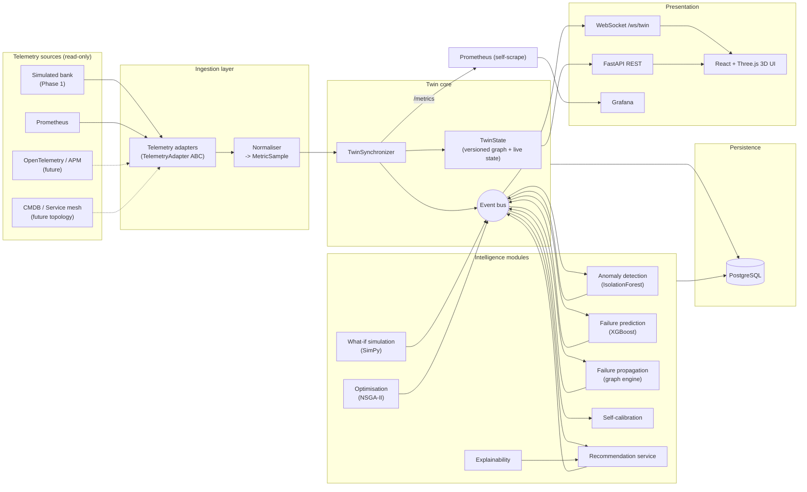
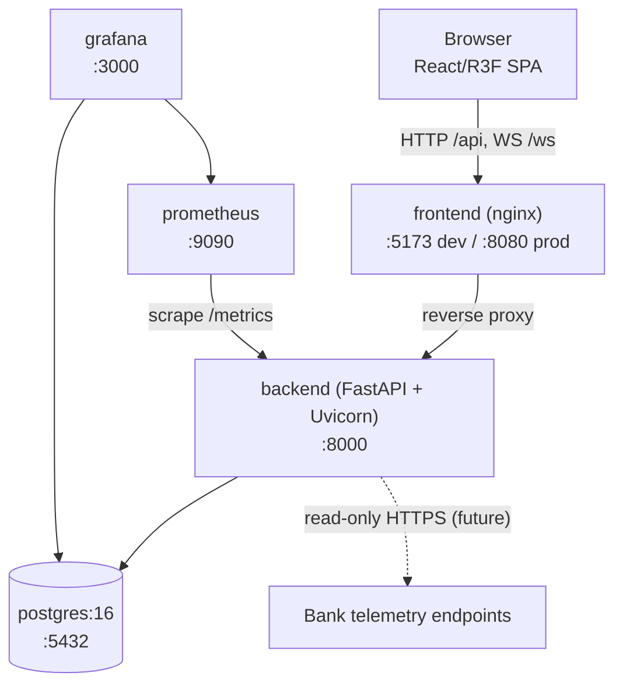

# 01 — System Architecture

SimuCore is a **self-calibrating 3D digital twin** of a banking software estate.
It mirrors microservices, databases, servers and network elements plus the
dependencies between them, keeps that mirror in sync with telemetry, predicts
failures, simulates "what-if" scenarios, proposes optimisations and explains
every recommendation.

## 1. Guiding principles

| Principle | Consequence |
|---|---|
| **Read-only toward production** | The twin never writes to banking systems. Adapters expose only read operations, enforced in the base class (see `03-twin-synchronization.md`). |
| **Simulation first** | Phase 1–5 run against a simulated bank (`SimulatedBankInfrastructure`). Real telemetry is plugged in later via adapters without touching the core. |
| **Contracts over coupling** | Modules talk through typed Pydantic contracts (`app/domain/contracts.py`) and an event bus — never by importing each other's internals. |
| **Explainability is mandatory** | No recommendation leaves the system without an `Explanation` (feature contributions + evidence + narrative). |
| **Closed feedback loop** | Every prediction is stored with its later actual outcome; the calibration module uses the error to retune models and simulation parameters. |

## 2. Logical architecture

## 3. Deployment architecture

All services are defined in `infra/docker-compose.yml`. The backend is a single
deployable ("modular monolith") in Phase 1–5; the module boundaries and the event
bus abstraction allow ML training and simulation workers to be split into
separate containers later (Phase 7) by swapping the in-process bus for Redis
Streams or NATS.

## 4. Module catalogue

| # | Capability | Package | Algorithm / tech | Inputs | Outputs |
|---|---|---|---|---|---|
| 1 | Real-time monitoring | `app/twin`, `app/adapters` | async polling/streaming, Prometheus | adapter samples | `twin.delta` events, WS stream |
| 2 | Anomaly & failure prediction | `app/ml` | IsolationForest (anomaly), XGBoost (failure probability over horizon) | metric windows | `AnomalyEvent`, `FailurePrediction` |
| 3 | Failure propagation | `app/propagation` | weighted reverse-dependency BFS (Phase 1), Monte-Carlo propagation (Phase 4) | failed nodes + graph | `PropagationResult` |
| 4 | 3D visualisation | `frontend/src/scene` | React Three Fiber | WS deltas, REST | interactive scene |
| 5 | What-if simulation | `app/simulation` | SimPy discrete-event simulation | `SimulationScenario` | `SimulationResult` |
| 6 | Resource optimisation | `app/optimization` | NSGA-II (pymoo) — cost vs latency vs risk | twin state, constraints | `OptimizationProposal` (Pareto front) |
| 7 | Self-calibration | `app/calibration` | error tracking (MAE/MAPE/Brier), drift detection (PSI/KS), parameter re-fit | predictions + actual outcomes | `CalibrationReport`, new model versions |
| 8 | Explainable recommendations | `app/explain`, `app/recommendation` | SHAP-style contributions (XGBoost `pred_contribs`), propagation paths, Pareto trade-offs | any decision artefact | `Recommendation` + `Explanation` |

## 5. Cross-cutting concerns

* **Security** — JWT/OIDC auth on the API (Phase 6), role-based access
  (viewer / operator / engineer / admin), adapter credentials from env/secret
  store only, full audit log table, CORS allow-list, no PII in telemetry.
* **Observability of SimuCore itself** — `/metrics` endpoint (Prometheus client),
  structured JSON logs, health `/api/v1/health` and readiness `/api/v1/ready`.
* **Determinism** — simulation and synthetic telemetry accept a random seed so
  experiments are reproducible (essential for the evaluation chapter of the
  project report).
* **Configuration** — `pydantic-settings`, prefix `SIMUCORE_`, see `.env.example`.

## 6. Key design decisions (ADR summary)

| ADR | Decision | Rationale |
|---|---|---|
| 001 | Modular monolith + in-process event bus first | Fast iteration for a project team; clear seams for later extraction. |
| 002 | Edge direction = "source depends on target" | Failure propagates **against** the edge direction; one convention everywhere. |
| 003 | PostgreSQL with native time-range partitioning for metrics | One database to operate; TimescaleDB is a drop-in upgrade if volume demands. |
| 004 | Twin state held in memory, persisted asynchronously | Sub-second UI latency; DB is the system of record for history and audit. |
| 005 | Adapters are read-only by construction | Banking compliance: the twin must not be able to mutate production. |
| 006 | NSGA-II via `pymoo` | Mature, well-documented multi-objective implementation. |
