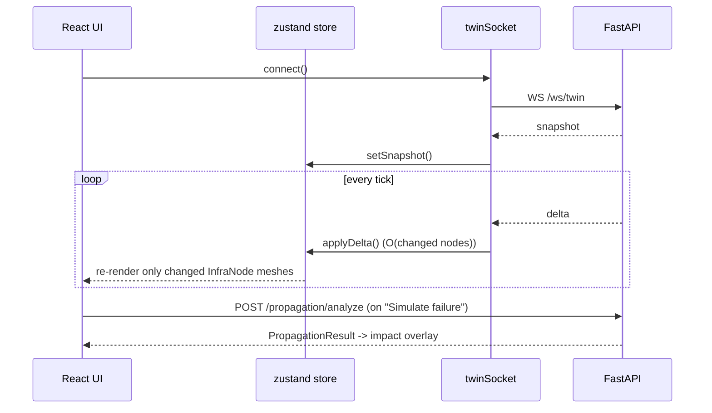

# 02 — Backend & Frontend Architecture

## Backend (Python 3.11+ / FastAPI)

### Layering

```
api (routers, WebSocket)          <- HTTP/WS boundary, auth, validation
  └─ services / modules           <- twin, propagation, ml, simulation, optimization,
                                     calibration, explain, recommendation
       └─ domain                  <- pure models + contracts + topology graph (no I/O)
            └─ adapters / db      <- telemetry adapters, PostgreSQL repositories
core (config, logging, events)    <- used by every layer
```

Rules:

1. `domain` imports nothing from other SimuCore packages.
2. Intelligence modules depend on `domain` and `core.events` only; they never
   import each other. Interaction happens via contracts on the event bus.
3. `api` is the only layer that knows about HTTP.

### Package map (`backend/app`)

| Package | Responsibility | Phase 1 status |
|---|---|---|
| `core/config.py` | Typed settings (`SIMUCORE_*` env vars) | implemented |
| `core/events.py` | Async pub/sub event bus + topic names | implemented |
| `core/logging.py` | Structured logging setup | implemented |
| `domain/models.py` | `Node`, `Edge`, `Topology`, `MetricSample`, `NodeState` | implemented |
| `domain/contracts.py` | Inter-module contracts (anomaly, prediction, simulation…) | implemented |
| `domain/topology.py` | `TopologyGraph` (networkx) dependency queries | implemented |
| `adapters/base.py` | `TelemetryAdapter` ABC, read-only guard | implemented |
| `adapters/simulated.py` | Adapter over the simulated bank | implemented |
| `adapters/prometheus.py` | Read-only Prometheus adapter | skeleton |
| `simulation/bank_topology.py` | Reference banking topology (27 nodes) | implemented |
| `simulation/infrastructure.py` | Synthetic telemetry generator w/ incidents | implemented |
| `simulation/whatif.py` | SimPy what-if engine | interface |
| `twin/state.py` | Versioned in-memory twin + health classification | implemented |
| `twin/sync.py` | Adapter → twin → bus synchronisation loop | implemented |
| `propagation/engine.py` | Weighted dependency failure propagation | reference impl. |
| `ml/` | Anomaly detector & failure predictor | interface |
| `optimization/` | NSGA-II optimiser | interface |
| `calibration/` | Actual-vs-predicted calibration | interface |
| `explain/` | Explanation builder | interface |
| `recommendation/` | Recommendation aggregation | interface |
| `db/` | SQLAlchemy session + repositories | Phase 2 |
| `api/v1/` | REST + WebSocket routes | implemented |

### API surface (v1)

| Method | Path | Purpose | Phase |
|---|---|---|---|
| GET | `/api/v1/health` | liveness | 1 |
| GET | `/api/v1/ready` | readiness (adapter connected, sync running) | 1 |
| GET | `/api/v1/topology` | nodes + edges | 1 |
| GET | `/api/v1/twin/state` | snapshot of all node states + version | 1 |
| GET | `/api/v1/twin/nodes/{id}` | node detail incl. dependencies/dependents | 1 |
| POST | `/api/v1/propagation/analyze` | blast-radius analysis for failed nodes | 1 |
| WS | `/ws/twin` | `snapshot` then `delta` messages | 1 |
| GET | `/metrics` | Prometheus exposition of SimuCore + twin gauges | 1 |
| GET | `/api/v1/anomalies`, `/predictions` | ML outputs | 3 |
| POST | `/api/v1/simulations` / GET `/simulations/{id}` | what-if runs | 4 |
| POST | `/api/v1/optimizations` / GET `/{id}` | NSGA-II runs | 5 |
| GET | `/api/v1/recommendations` | explainable recommendations | 5 |
| GET | `/api/v1/calibration/reports` | calibration history | 5 |

### WebSocket protocol (`/ws/twin`)

```jsonc
// server -> client, once on connect
{ "type": "snapshot", "version": 120, "topology": {...}, "states": [...] }
// server -> client, every sync tick (default 1 s)
{ "type": "delta", "version": 121, "states": [ { "node_id": "...", "status": "degraded", "metrics": {...}, "updated_at": "..." } ] }
// later phases add: "anomaly", "prediction", "propagation", "simulation_progress", "recommendation"
// client -> server (Phase 3+): { "type": "subscribe", "channels": ["anomaly","recommendation"] }
```

---

## Frontend (React 18 + TypeScript + Vite + React Three Fiber)

### Structure (`frontend/src`)

| Folder | Responsibility |
|---|---|
| `types/` | TypeScript mirrors of backend contracts |
| `services/` | `api.ts` (REST), `twinSocket.ts` (WS with auto-reconnect) |
| `store/` | `zustand` store: topology, node states, selection, impact overlay, connection status |
| `scene/` | 3D: `TwinCanvas`, `InfraNode`, `DependencyEdge`, `LayerPlane`, `layout.ts` |
| `components/` | 2D overlay UI: top bar, inspector, legend, impact analysis, module navigator |
| `styles.css` | design tokens (dark NOC theme) |

### Data flow



Rendering performance: each `InfraNode` subscribes to **its own** slice of the
store (`useTwinStore(s => s.states[id])`) so a delta re-renders only changed
meshes. For >2 000 nodes, Phase 7 switches to `InstancedMesh`.
