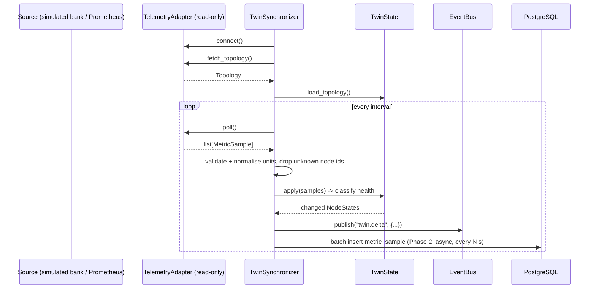
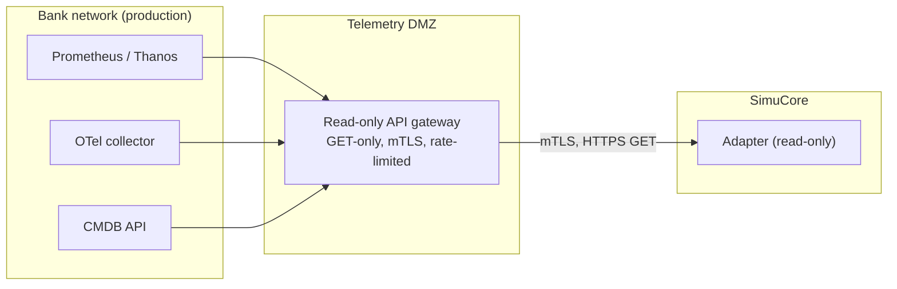

# 03 — Digital Twin Synchronisation & Telemetry Adapters

## 1. What "synchronised" means

The twin has two kinds of state:

| State | Changes | Source | Sync strategy |
|---|---|---|---|
| **Structural** (topology: nodes, edges, attributes) | rarely | adapter `fetch_topology()` (later: CMDB / service mesh / k8s API) | full reconcile at start-up + periodic diff (default 5 min) |
| **Operational** (metrics, health) | continuously | adapter `poll()` (called each tick) | push/poll per tick (default 1 s), delta broadcast |

Each applied tick increments `TwinState.version`. Clients detect gaps by
version and request a fresh snapshot if they miss deltas.

## 2. Pipeline



### Health classification (Phase 1 rules, Phase 3 replaced by ML scores)

| Metric | degraded ≥ | critical ≥ |
|---|---|---|
| `cpu_pct` | 75 | 90 |
| `mem_pct` | 80 | 92 |
| `error_rate` | 0.02 | 0.08 |
| `latency_ms` | 1.8 × baseline | 3 × baseline |
| `availability` | — | `0` ⇒ **down** |

Node status = worst metric status.

## 3. Freshness & drift

* **Staleness** — if a node receives no sample for `3 × interval`, status becomes
  `unknown` (rendered grey/translucent in 3D).
* **Fidelity drift** — the calibration module (Phase 5) compares the twin's
  *predicted* next state (from the SimPy model and ML forecasts) with the
  *actual* sample. Error statistics feed `prediction_outcome` and trigger
  recalibration when thresholds are breached (see `04-module-communication.md`).

## 4. Normalised telemetry model

```python
MetricSample(node_id="payments-service", ts=datetime, metrics={
    "cpu_pct": 41.2, "mem_pct": 63.0, "latency_ms": 38.5,
    "error_rate": 0.004, "rps": 812.0, "availability": 1.0
})
```

Standard metric keys are listed in `app/domain/models.py::STANDARD_METRICS`.
Adapters must map source-specific names to these keys.

## 5. Future production integration — secure read-only adapters



Security controls (all mandatory before connecting to a real bank):

1. **Read-only by construction** — `TelemetryAdapter` exposes no write method;
   HTTP adapters use `ReadOnlyHttpClient`, which raises on any verb other than
   `GET`/`HEAD` (implemented in `adapters/base.py`).
2. **Least-privilege credentials** — service accounts with viewer-only scopes;
   credentials injected via env / Vault, never stored in the DB or repo.
3. **Transport** — HTTPS with mTLS; certificate pinning for the telemetry gateway.
4. **Network** — SimuCore reaches only an allow-listed DMZ gateway, never
   production hosts directly. Outbound only; no inbound path from SimuCore.
5. **Data minimisation** — only infrastructure metrics; no customer data, account
   numbers or transaction payloads. Labels are scrubbed against a deny-list.
6. **Rate limiting & back-off** — per-adapter max request rate; circuit breaker
   so the twin can never load production monitoring.
7. **Audit** — every adapter connect/query is written to `audit_log`.
8. **Isolation of simulation** — what-if scenarios run only on the twin's copy;
   there is no code path from simulation results to production.

### Adding a new adapter

1. Subclass `TelemetryAdapter`; implement `connect`, `fetch_topology`, `poll`, `close`.
2. Map source metric names → `STANDARD_METRICS`.
3. Register it in `app/adapters/__init__.py::ADAPTERS`.
4. Select it with `SIMUCORE_TELEMETRY_ADAPTER=<name>`.
5. Add contract tests in `tests/adapters/` (same suite the simulated adapter passes).
