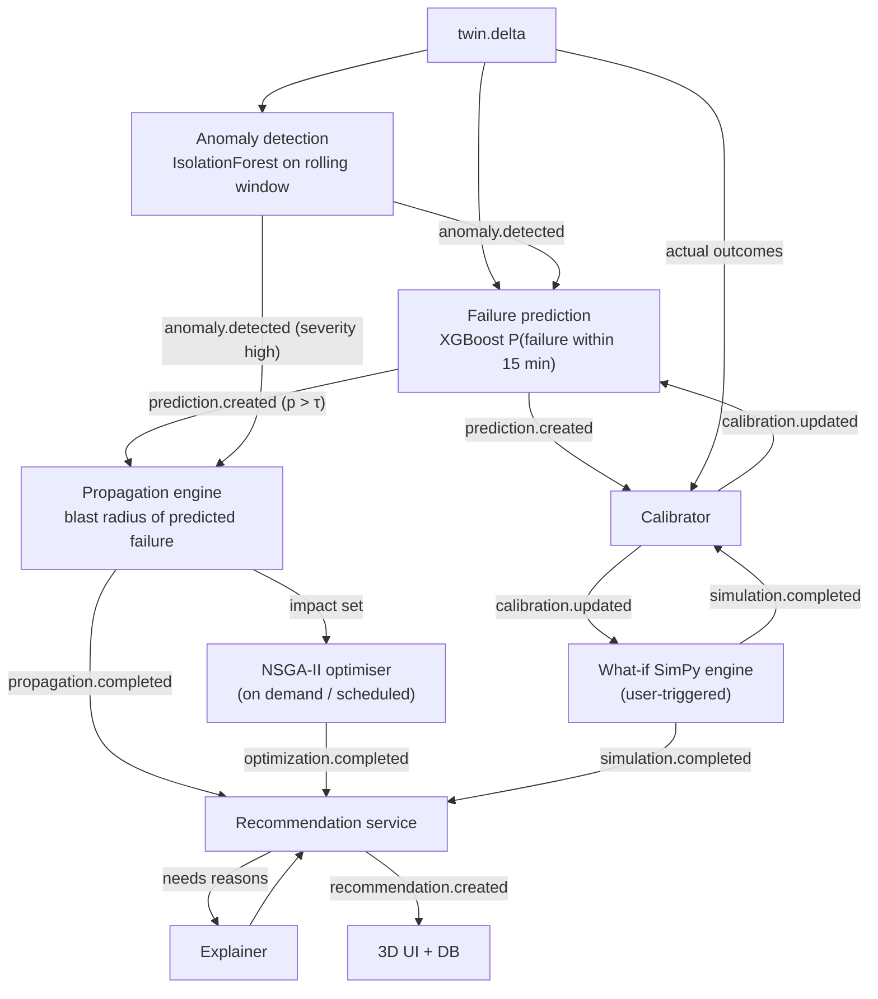

# 04 — How the Algorithms Communicate

All modules communicate through **typed contracts** (`app/domain/contracts.py`)
published on the **event bus** (`app/core/events.py`). Long-running jobs
(simulation, optimisation, training) are invoked through REST, run as
background tasks, and announce completion on the bus.

## 1. Event topics

| Topic | Producer | Payload contract | Consumers |
|---|---|---|---|
| `twin.delta` | TwinSynchronizer | `{version, states: NodeState[]}` | WS gateway, Anomaly, Predictor, Calibration, Prometheus exporter |
| `twin.topology` | TwinSynchronizer | `Topology` | all modules (graph refresh) |
| `anomaly.detected` | AnomalyDetector | `AnomalyEvent` | Predictor, Propagation, Recommendation, WS |
| `prediction.created` | FailurePredictor | `FailurePrediction` | Propagation, Calibration, Recommendation, WS |
| `propagation.completed` | PropagationEngine | `PropagationResult` | Recommendation, Optimisation, WS |
| `simulation.completed` | WhatIfEngine | `SimulationResult` | Calibration, Recommendation, WS |
| `optimization.completed` | Optimiser | `OptimizationProposal` | Recommendation, WS |
| `calibration.updated` | Calibrator | `CalibrationReport` | Predictor (reload model), WhatIfEngine (new params), WS |
| `recommendation.created` | RecommendationService | `Recommendation` (+ `Explanation`) | WS, DB |

## 2. End-to-end flow

## 3. Module contracts in detail

### Anomaly detection (`app/ml/anomaly.py`)
* **In:** rolling window (default 60 ticks) of `NodeState.metrics` per node.
* **Algorithm:** IsolationForest per node *kind* (services, databases, servers, network)
  trained on healthy baseline; z-score fallback while untrained.
* **Out:** `AnomalyEvent(node_id, score ∈ [0,1], severity, contributing_metrics, model_version)`.

### Failure prediction (`app/ml/predictor.py`)
* **In:** engineered features (means, slopes, std, max over windows; dependency
  health aggregates; anomaly score).
* **Algorithm:** XGBoost binary classifier, label = node reaches `critical`/`down`
  within horizon *H* (default 15 min). Trained on simulated incident data
  (Phase 3), later on historical data.
* **Out:** `FailurePrediction(node_id, horizon_s, probability, predicted_at, model_version, top_features)`.
  Stored in `prediction`; resolved later into `prediction_outcome`.

### Failure propagation (`app/propagation/engine.py`)
* **In:** failed/at-risk nodes (+ probabilities), `TopologyGraph`.
* **Algorithm (Phase 1):** impact(dependent) = max(impact(dependency) × edge.weight × decay),
  BFS against edge direction, pruned below threshold.
  **Phase 4:** Monte-Carlo propagation with per-edge failure probabilities and
  redundancy (k-of-n replicas) awareness.
* **Out:** `PropagationResult(origin, impacted[{node_id, impact, depth, path}], business_impact)`.

### What-if simulation (`app/simulation/whatif.py`)
* **In:** `SimulationScenario(faults[], load_multiplier, duration_s, seed)`.
* **Algorithm:** SimPy discrete-event model — each service is a resource with
  capacity/latency distribution; requests flow along dependency edges;
  injected faults change capacity/error rates; calibrated parameters come from
  the Calibrator.
* **Out:** `SimulationResult(kpis: p95 latency, error %, failed txn/min, SLA breaches, timeline)`.

### Optimisation (`app/optimization/nsga2.py`)
* **In:** twin state, propagation risk, constraints (budget, min replicas, SLA).
* **Decision variables:** replica count / CPU / memory allocation per service.
* **Objectives (minimise):** infrastructure cost, predicted p95 latency
  (via surrogate or fast SimPy run), failure risk (from propagation).
* **Algorithm:** NSGA-II (`pymoo`), population 60–100, 50–200 generations.
* **Out:** `OptimizationProposal(pareto_front[], recommended_index, objectives)`.

### Self-calibration (`app/calibration/calibrator.py`)
* **In:** pairs of (predicted, actual) — ML probabilities vs observed failures,
  SimPy-predicted latency vs observed latency.
* **Metrics:** Brier score & reliability curve (classifier), MAE/MAPE (regression,
  simulation), PSI / KS-test for feature drift.
* **Actions:** Platt/isotonic re-calibration of probabilities; Bayesian/least-squares
  re-fit of SimPy service-time parameters; trigger retraining when drift > threshold.
* **Out:** `CalibrationReport(target, metric_before, metric_after, drift, action, new_version)`.

### Explainability (`app/explain/explainer.py`)
* For predictions: XGBoost `pred_contribs` (exact TreeSHAP) → top-k features.
* For propagation: the dependency path(s) that carried the impact.
* For optimisation: objective trade-offs vs current configuration.
* **Out:** `Explanation(summary, factors[{name, value, contribution}], evidence[], confidence)`.

### Recommendation service (`app/recommendation/service.py`)
Combines the above into actionable, de-duplicated, prioritised `Recommendation`
items (`priority = probability × business_impact`), each carrying an
`Explanation`. Recommendations are advisory only — no automated actions on
production.
