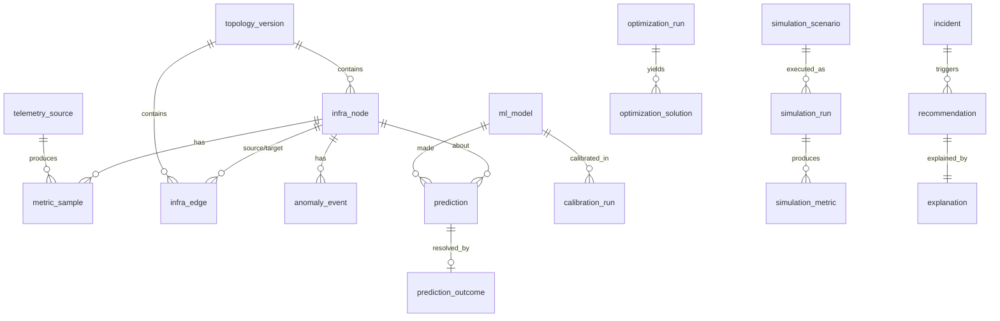

# 05 — Database Schema (PostgreSQL 16)

The executable DDL is in [`database/schema/001_init.sql`](../database/schema/001_init.sql)
and is applied automatically by the Postgres container on first start.
From Phase 2 onward schema changes are managed with Alembic migrations in
`backend/migrations/`.

## ER overview

## Tables

| Group | Table | Purpose |
|---|---|---|
| Topology | `topology_version` | immutable versions of the structure (for replay / audits) |
| | `infra_node` | service, database, server, network, cache, queue, gateway… |
| | `infra_edge` | dependency `source → target` (source depends on target) with `weight` |
| Telemetry | `telemetry_source` | registered adapters (type, endpoint, read_only flag) |
| | `metric_sample` | time-series, **range-partitioned by month** on `ts` |
| | `node_state_snapshot` | periodic health snapshots (cheap replay in UI timeline) |
| Intelligence | `ml_model` | model registry: type, version, params, metrics, artefact path |
| | `anomaly_event` | detected anomalies |
| | `prediction` | failure predictions |
| | `prediction_outcome` | actual result paired with prediction → calibration input |
| | `calibration_run` | calibration history (before/after metrics, drift, action) |
| Simulation | `simulation_scenario` | reusable what-if definitions (faults JSONB) |
| | `simulation_run` | each execution (seed, params version, status) |
| | `simulation_metric` | time-series KPIs of a run |
| | `propagation_analysis` | stored blast-radius results |
| Optimisation | `optimization_run` | NSGA-II configuration & status |
| | `optimization_solution` | Pareto-front members (decision vector + objectives) |
| Decisions | `incident` | detected/simulated incidents |
| | `recommendation` | advisory actions, priority, status |
| | `explanation` | factors, evidence, narrative for a recommendation |
| Governance | `app_user` | users & roles |
| | `audit_log` | every user action and adapter access |

Design notes:

* UUID primary keys (`gen_random_uuid()`), `timestamptz` everywhere (UTC).
* Flexible per-kind attributes and metrics use `JSONB` with GIN indexes; the hot
  standard metrics are columns on `metric_sample` for fast aggregation.
* Enumerations are PostgreSQL `ENUM` types mirroring `app/domain/models.py`.
* `002_grafana_readonly.sh` creates `grafana_reader`, which can only `SELECT`. Grafana uses it, never
  the owner's account.
* **Partitions must exist before their data.** A monthly partition cannot be created once rows for
  that month sit in `metric_sample_default` (measured: PostgreSQL refuses with 23514). The persistence
  phase must create partitions ahead of time and treat rows in the default partition as an alarm.
* The rule "every recommendation has an explanation" is enforced by the Python contract, not yet by
  the database: a recommendation row can exist without an explanation row.
* Retention: raw `metric_sample` partitions dropped after 30 days (configurable);
  downsampled aggregates kept (Phase 2 materialised view `metric_sample_5m`).
