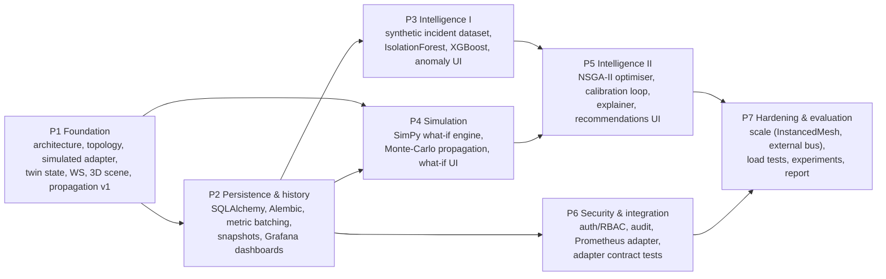

# 07 — Development Roadmap

## Module dependency graph

## Phases

| Phase | Deliverables | Depends on | Exit criteria |
|---|---|---|---|
| **1 Foundation** *(this phase)* | Docs, folder structure, domain models & contracts, reference bank topology, synthetic telemetry, read-only adapter base, twin state + sync loop, REST + WS, propagation v1, 3D scene with live colours, Docker/Prometheus/Grafana config | — | backend tests pass, frontend type-checks & builds, live twin visible in browser |
| **2 Persistence** | SQLAlchemy models, Alembic baseline from `001_init.sql`, async batch writer for `metric_sample`, snapshot job, partition maintenance, history API, Grafana dashboards | P1 | 24 h simulated run persisted; history endpoint < 200 ms for 1 h window |
| **3 Intelligence I** | Incident-injection scenarios in simulator, labelled dataset generator, feature pipeline, IsolationForest per kind, XGBoost failure predictor, model registry, anomaly & prediction events + 3D badges | P2 | predictor ROC-AUC ≥ 0.85 and lead time ≥ 5 min on held-out simulated incidents |
| **4 Simulation** | SimPy request-flow model, fault library (crash, latency, saturation, network partition), scenario API & runner, Monte-Carlo propagation, what-if UI mode | P1, P2 | simulated baseline KPIs within ±10 % of live synthetic telemetry |
| **5 Intelligence II** | Calibration service (Brier, MAPE, PSI; isotonic recalibration; SimPy parameter re-fit), NSGA-II optimiser, explainer, recommendation service + UI, Pareto chart | P3, P4 | calibration reduces error ≥ 20 % after injected drift; every recommendation has an explanation |
| **6 Security & integration** | OIDC/JWT, RBAC, audit log wiring, Prometheus adapter end-to-end, adapter contract test suite, secrets handling | P2 | adapter passes contract suite against a real Prometheus; no write verbs reachable |
| **7 Hardening & evaluation** | 1 000+ node topology, InstancedMesh rendering, Redis/NATS bus option, load tests, experiment notebooks, final report | P5, P6 | 60 fps at 1 000 nodes; documented experimental results |
| **Banking services** *(done, added to the plan after Phase 1)* | Eight FastAPI microservices, enforced dependency map, workloads, fault injection, Docker files, live scenarios (`banking-sim/`, doc 08) | P1 | all live scenarios pass, as local processes and as Docker containers |
| **Live twin adapter** *(done)* | Read-only adapter from `/telemetry` to the twin, so the 3D view shows the running services | Banking services | killing a service turns its node red within 3 s |
| **Monitoring** *(done)* | Monitoring service, full metric set, Prometheus and exporters, PostgreSQL history, quality events, WebSocket, twin adapter, synthetic data (`monitoring/`, doc 09). Covers most of P2 Persistence: metric storage, partitions, history API | Banking services | every metric matches independent truth through two pipelines; every monitoring failure is detected |
| **Digital twin core** *(done)* | Virtual infrastructure, six statuses, live synchronisation, history, API v2 and WebSocket with a published format for the 3D frontend (`backend/app/digital_twin`, doc 10) | Monitoring | every real change is reflected; chaos test without a mismatch |
| **3D interface** *(done)* | Interactive 3D data centre on API v2: live statuses and metrics, request flow, isolate, dependency view, search, alerts, history (`frontend/`, doc 11). Includes the instanced rendering planned for P7 | Digital twin core | every interaction and real fault verified in a real browser; 1 000 objects above 50 fps |
| **AI module** *(done; covers P3 Intelligence I)* | Isolation Forest and XGBoost on labelled synthetic data, AI service, storage with outcomes, opinions in the twin and the 3D interface (`intelligence/`, doc 12) | Monitoring, digital twin core | validated on held-out synthetic episodes and on real runs recorded after the models were frozen |
| **Failure propagation** *(done; replaces propagation v1 on the live twin)* | Directed weighted graph built from the twin's structure, BFS impact, critical components, events judged against later measurements, 3D path and simulation (`backend/app/digital_twin/propagation.py`, doc 13). Monte-Carlo propagation stays in P4 | Digital twin core, 3D interface | predictions compared with measured effects of real crashes; every structure change rebuilds the graph |

The phase numbers above are unchanged; the unnumbered rows come between P1 and P2.

## Phase 2 backlog

1. `backend/app/db/models.py` (SQLAlchemy 2.0) mirroring `001_init.sql`.
2. Alembic init + baseline revision.
3. `MetricWriter` subscriber on `twin.delta` with batching (500 rows / 5 s).
4. `GET /api/v1/twin/nodes/{id}/history?from=&to=&step=`.
5. Grafana dashboards `simucore-overview`, `simucore-node`.
