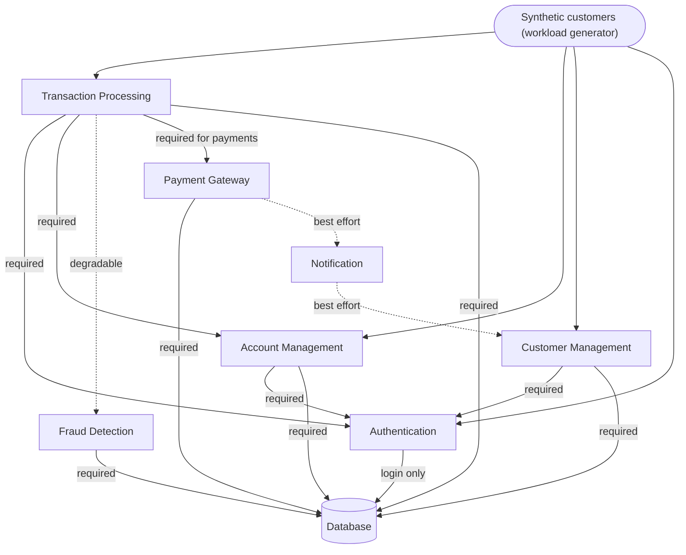
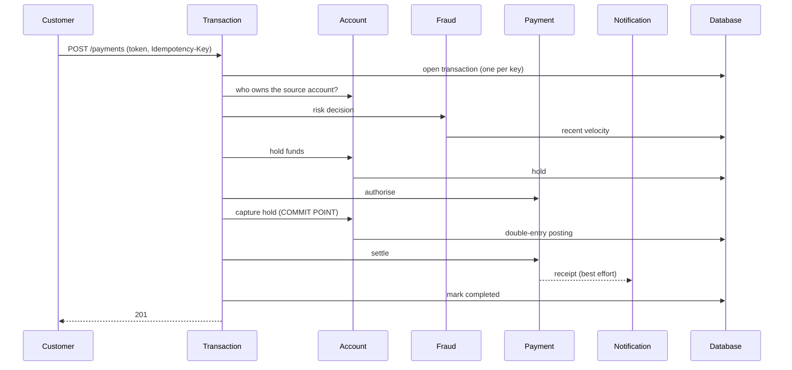

# 08 — Simulated Banking Microservices

Eight independent FastAPI services in [`banking-sim/`](../banking-sim). They play the part of
"production" for the digital twin. All data is synthetic, nothing leaves the machine, and there is
no connection to any real banking system.

## 1. Services

| Service | Port | Responsibility | Customer endpoints | Internal endpoints |
|---|---|---|---|---|
| Authentication | 8101 | Login, signed tokens, token verification | `POST /login` | `POST /internal/verify` |
| Customer Management | 8102 | Customer profiles | `GET /customers/me` | `GET /internal/customers/{id}` |
| Account Management | 8103 | Balances; holds and postings | `GET /accounts`, `GET /accounts/{id}` | `/internal/accounts`, `/internal/holds/...` |
| Transaction Processing | 8104 | Orchestrates transfers and payments | `POST /transfers`, `POST /payments`, `GET /transactions/{id}` | — |
| Payment Gateway | 8105 | Authorise, capture, void; external network simulated in-process | — | `/internal/payments/...` |
| Fraud Detection | 8106 | Rule-based risk score: allow, review, deny | — | `POST /fraud/checks` |
| Notification | 8107 | Asynchronous receipts into an in-memory outbox | — | `/internal/notifications` |
| Database | 8108 | Sole owner of storage (SQLite, WAL) behind a bounded connection pool | — | `/internal/...` |

Every service also has `GET /health/live` (is the process up), `GET /health/ready` (can it work,
judged by how important each dependency is), `GET /health` (both), `GET /metrics` (Prometheus),
`GET /telemetry` (SimuCore's six standard metrics, observed calls, circuit states, active faults)
and, with the internal key, `POST|DELETE /control/faults` and `POST /control/shutdown`.

## 2. Dependency map

The map is one file, [`banking-sim/dependency_map.json`](../banking-sim/dependency_map.json).
Services **refuse** to make a call that is not declared in it, and scenario S23 checks that every
declared edge is really used. SimuCore loads the same file as a twin topology
(`backend/app/simulation/bank_services.py`).

| Mode | Meaning when the dependency is down |
|---|---|
| required | the caller answers 503 and names the failure path |
| degradable | the caller continues with a safe fallback (fraud: amounts up to 500.00 XTS proceed unscreened, larger ones are refused) |
| best_effort | the caller succeeds anyway (receipts) |

The four chains in the project brief are all present. The remaining edges are what those services
need to work: token checks, transaction records, payment state, fraud velocity and the contact
lookup for receipts.

## 3. A payment, step by step

Money safety: integer minor units of XTS (the ISO 4217 code reserved for testing), double entry,
one write transaction per posting. A hold becomes exactly one of *captured* or *released*. When the
reply to the capture is lost, the release call reports which of the two happened. Anything
abandoned is closed by a reconciler after the hold expires (60 s by default). `GET
/internal/integrity` recomputes every invariant from the ledger.

Resilience: per-call time budgets, one retry only for connections broken by a restart, a circuit
breaker per dependency (5 failures, 3 s cool-down, one probe), and a concurrency limit with a
bounded queue per service.

## 4. Workloads

`python bankctl.py workload <profile> [--rps N] [--duration S]`. Arrivals are open-loop Poisson,
so the generator does not slow down when the bank does.

| Profile | Default rate | Contents |
|---|---|---|
| normal | 10/s steady | account queries 50 %, transfers 18 %, payments 12 %, profiles 10 %, fraud checks 7 %, logins 3 % |
| peak | ramps to 40/s and back | same, with more transfers and payments |
| abnormal | 15/s base, 3× bursts | wrong secrets, forged tokens, other people's accounts, overdrafts, very large and watch-listed transfers, declined payments, malformed requests, plus some ordinary traffic |

Outcomes are **ok**, **rejected** (a correct business refusal) or **failed** (the system let the
customer down). Mixing the last two would make a fraud denial look like an outage.

## 5. Failure simulation

| Failure | Command | What really happens |
|---|---|---|
| Crash | `bankctl.py kill account` | the process is killed |
| Planned stop | `bankctl.py stop account` | graceful shutdown of that one process |
| Soft downtime | `bankctl.py fault fraud downtime` | 503 to everything, health included |
| High latency | `bankctl.py fault database latency --latency-ms 800` | delay on each business request |
| CPU exhaustion | `bankctl.py fault transaction resource_exhaustion --mode cpu` | threads burn CPU inside the process; measured median transfer time: magnitude 0.25 up to 1.4×, 0.5 about 2–6×, 0.75 about 12–37×, 1.0 crippled (Linux container) or refused (Windows process) |
| Memory exhaustion | `... --mode memory` | allocates up to the 256 MB budget; requests are shed |
| Worker exhaustion | `... --mode slots` | occupies concurrency slots; requests queue, then are shed |
| DB connections refused | `bankctl.py fault database db_connection_failure --mode refuse` | every acquire fails |
| DB pool exhausted | `... --mode exhaust` | real pool connections are held; acquires time out |

Faults have a mandatory duration (at most 10 minutes) and expire on their own. `bankctl.py clear`
removes them.

## 6. Safety boundaries

* The HTTP client accepts only loopback addresses and the eight container names.
* Names are `Synthetic Customer 00001`, addresses are at `example.invalid`, accounts are
  `SIM-00001-01`, login secrets are derivable on purpose. None of it describes a real person.
* The internal key is random, generated locally in `.runtime/` (or supplied in `.env` for Docker),
  and never committed. Ports bind to 127.0.0.1 only.

## 7. Known limits

* Storage is SQLite behind the Database Service, not PostgreSQL. The service boundary is what the
  other seven see, so it can be replaced without touching them.
* Service-to-service security is one shared key over plain HTTP. Adequate for a sandbox only.
* A receipt is lost if the Notification Service is down when the payment settles, and queued
  receipts are lost if it crashes. Payments are unaffected.
* Restarting Authentication invalidates all tokens (its signing key is per process).
* A dead dependency costs its callers up to 500 ms per call (the connection timeout) until the
  circuit opens, even when the dependency is only "best effort".

## 8. Live digital twin

`SIMUCORE_TELEMETRY_ADAPTER=bank_services` makes the twin show these services
(`backend/app/adapters/bank_services.py`). Once per second it sends one `GET /telemetry` to each
service. It never holds the internal key, accepts only loopback and the eight container names,
does not follow redirects, and validates everything it reads.

| What happens | What the twin shows |
|---|---|
| service answers | its metrics, judged against that service's measured baseline |
| connection refused, or the service reports itself unavailable | **down** |
| hung, slow, or nonsense telemetry | **unknown** after 3 s; it does not guess |

A service with no traffic has no latency or errors, so a broken caller looks healthy until somebody
uses it. Baselines are the p95 measured on one Windows laptop under the normal workload; re-measure
them elsewhere (`baseline_latency_ms` in the dependency map).

Measured results: [local processes](../backend/results/live_twin.md),
[Docker containers](../backend/results/live_twin_docker.md).

### First predicted-versus-observed comparison

Six services were killed three times each under steady load, with a no-fault control (which raised
nothing). "Affected" means degraded or critical for at least two readings in most trials; the
prediction counts impact of 0.5 or more.

| Killed | Predicted | Observed | Difference |
|---|---|---|---|
| database | account, customer, fraud, payment, transaction | account, authentication, customer, fraud, transaction | missed authentication; payment not observed, because no payment got far enough to reach it |
| authentication | account, customer, transaction | same | none |
| account | transaction | same | none |
| payment | transaction | same | none |
| fraud | none | transaction (slow) | missed |
| notification | none | payment, transaction (slow, 0 % errors) | missed both |

Precision 0.90, recall 0.69, with the same hits and misses on local processes and on containers. The model predicts who *fails* but not who merely becomes *slow* while
waiting for a dead optional dependency. The edge weights were not tuned to fit this result: closing
that gap is the job of the calibration phase, and this is its first data. Six origins on
one computer is a small sample.
