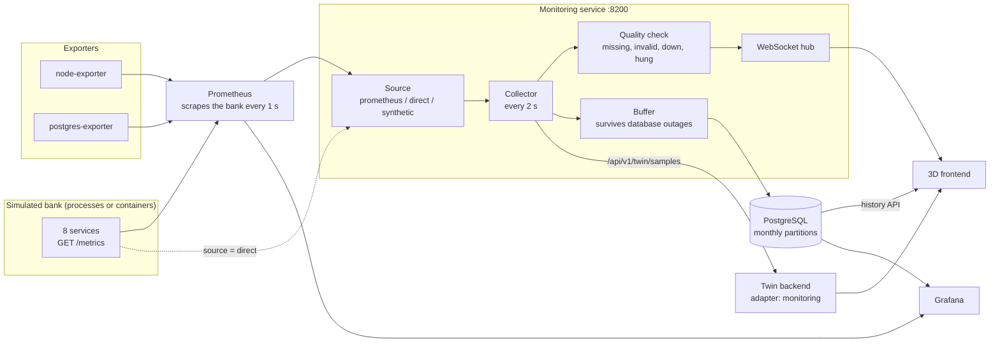

# 09 — Real-Time Monitoring and Data Collection

The monitoring service ([`monitoring/`](../monitoring)) continuously collects metrics from all eight
simulated banking services and from the platform itself, checks them, stores them in PostgreSQL and
streams them to the digital twin and the 3D frontend. It only reads.

## 1. Pipeline



## 2. Metrics

| Required | Key(s) | How it is measured |
|---|---|---|
| CPU utilisation | `cpu_pct` | growth of the process's CPU-time counter; 100 % = one core |
| Memory utilisation | `mem_pct`, `mem_bytes` | process memory against its 256 MB budget |
| Request latency | `latency_ms` (p95), `latency_mean_ms` | histogram around every business request |
| Requests per second | `rps` | growth of the request counter |
| Error rate | `error_rate` | share of 5xx; client errors (4xx) do not count |
| Network traffic | `net_rx_bps`, `net_tx_bps` | application-layer bytes (headers and bodies) of business traffic, in both directions, including calls to other services |
| Database response time | `db_response_ms` | mean time of the service's calls to the database; for the Database Service itself, query time including the wait for a connection |
| Active connections | `active_connections` | open inbound TCP connections, idle ones and the scraper's own included |
| Service availability | `availability`, `status` | reachable and accepting work; history as a ratio |
| Request queue length | `queue_length`, `in_flight` | requests waiting for, or holding, a worker slot |

| *(added for the digital twin)* network connections | `calls_per_s`, `failure_rate`, `latency_ms`, `circuit` per service pair | measured by the caller for each of the 14 declared connections; calls refused by an open circuit count as failures |
| *(added)* bank database | `db_pool_in_use`, `db_pool_size`, `db_failure_rate` | from the Database Service's connection pool |

Rates use a 10 s window. The catalogue with units and limits is at `GET /api/v1/metrics/catalog`.

**Service level:** the table above, per service. **Infrastructure level:** the Docker machine (CPU,
memory, load, disk), the platform's PostgreSQL (connections, size, commits, cache hits), Prometheus
(targets, scrape time, series), and the bank as a whole (services up, total requests, error rate
weighted by traffic, total network).

### Three things that must not be confused

| | What it means | What is stored |
|---|---|---|
| **no value** (`null`) | the service is idle; there is no latency without requests | `NULL`, no alarm |
| **missing** | the series should be there and is not | `NULL` and a `metric_missing` event |
| **invalid** | the value is impossible (negative, NaN, out of range) | `NULL` and a `metric_invalid` event |

Every monitored series exists from a service's first scrape, with value 0, so an absent series always
means that collection is broken.

Likewise `down` (connection refused, or the service says so) is not `unresponsive` (hung, or its
metrics page is unreadable): the second says nothing about the service, so the twin shows *unknown*.

## 3. Detecting monitoring failures

| Event | Opens after | Severity |
|---|---|---|
| `service_down` | 1 tick (2 s) | critical |
| `service_unresponsive` | 2 ticks | high |
| `metric_missing` | 4 ticks | medium |
| `metric_invalid` | 2 ticks | medium |
| `component_down` (exporter, PostgreSQL, Prometheus) | 2 infrastructure reads | high |
| `source_unavailable` (Prometheus stopped, hung, or without targets) | 2 ticks | critical |
| `store_failed` (history not being saved) | 2 ticks | high |
| `samples_dropped` (outage longer than the buffer) | 1 tick | high |
| `clock_skew`, `collector_slow` | 5 / 3 ticks | medium |

An event closes after two good ticks. When the source itself fails, service events neither open nor
close, because nothing is known: a stopped Prometheus raises one alarm, not eight false ones. The
last data stays visible but is marked `fresh: false` and is no longer given to the twin. Prometheus
in turn scrapes the monitoring service, so the monitor's own death is visible there.

## 4. Storage

* `metric_sample` (service level), `link_metric_sample` and `infra_metric_sample`, partitioned by month;
  `monitoring_event` for problems. Migration: `database/migrations/003_monitoring.sql`.
* The one-shot `migrate` container applies migrations once each, on new and existing databases.
* `monitor_writer` may append samples and manage its events. It cannot change or delete history.
  Partition upkeep goes through two functions that check their arguments.
* During a database outage, rows wait in memory (120,000 rows, about 3 hours) and are written
  afterwards. Anything beyond that is counted and raised as an event. A row the database rejects is
  skipped and counted, so it cannot block the others.
* Retention is 30 days, whole months at a time.

## 5. API (read-only, port 8200)

| Method | Path | |
|---|---|---|
| GET | `/health/live`, `/health/ready` | process; collector loop turning |
| GET | `/api/v1/monitoring/status` | state of every pipeline stage |
| GET | `/api/v1/metrics/catalog` | metrics, units, limits, event kinds |
| GET | `/api/v1/metrics/current[/{service}]` | latest values |
| GET | `/api/v1/metrics/history/{service}?metrics=&start=&end=&minutes=&step=&origin=` | average, minimum and maximum per step |
| GET | `/api/v1/metrics/availability` | share of samples up, per service |
| GET | `/api/v1/links/current` | network connections |
| GET | `/api/v1/infrastructure/current`, `/history/{component}` | infrastructure level |
| GET | `/api/v1/events/open`, `/history` | problems |
| GET | `/api/v1/twin/samples` | for the digital twin backend |
| WS | `/ws/metrics` | `snapshot`, then an `update` every tick with values and changed events |
| GET | `/metrics` | the monitor's own metrics |

Times must carry a zone. WebSocket clients may send
`{"type":"subscribe","services":["account"]}` (or `null` for all). A client that reads too slowly
skips old updates and is told how many; it cannot delay the others. Browsers from other origins are
refused.

## 6. Synthetic data

`MONITOR_SOURCE=synthetic` produces plausible data without a bank;
`python -m monitor.backfill --hours 24` writes synthetic history. Every sample carries its `origin`.
History and availability return measured data unless `origin=synthetic` is requested, the two are
separate rows even for the same moment, and the UI shows a **SYNTHETIC DATA** badge. Same seed and
time give the same values. Synthetic data is never used to fill gaps in measured data.

## 7. Running it

Whole stack (Prometheus pipeline), with the bank running in either mode:

```powershell
docker compose --env-file .env -f infra/docker-compose.yml up -d --build
```

Set `SIMUCORE_TELEMETRY_ADAPTER=monitoring` in `.env` to make the 3D twin show it.

Without Docker (reads the services directly, no history):

```powershell
cd monitoring; .\.venv\Scripts\python -m uvicorn monitor.main:app --port 8200
```

```powershell
cd backend; .\.venv\Scripts\python -m uvicorn app.main:app --env-file monitoring.env --port 8000
```

## 8. Test results

Each metric was compared, through two independent pipelines, with a truth that comes from neither:
operating-system counters, exact request counts, bytes counted by the client, real sockets.

* [Bank as local processes](../monitoring/results/pipelines.md)
* [Bank as Docker containers](../monitoring/results/pipelines_docker.md)
* Re-run: `monitoring\.venv\Scripts\python live\pipeline_check.py` (about 16 minutes; the bank and
  the stack must be down)

## 9. Known limits

* p95 latency is interpolated between histogram buckets, as Prometheus does. In the recorded tests it
  was 8-11 % higher than the client's own measurement. The mean was 4-7 % lower, partly because the
  client's stopwatch also covers its own overhead and the connection.
* Network traffic counts application bytes, not TCP/IP overhead, and not health or metrics pages.
  There is no host-level network figure: in a container the exporter sees only its own network.
* `docker-host` is Docker Desktop's Linux machine, not Windows itself. In direct mode, the
  `monitor-host` component is the computer the monitor runs on.
* Counted from the moment the kill command had returned, a crash was visible after 1.7-2.9 s, in the
  twin after 0.8-3.7 s, and a hung service after 2-3 s. Missing metrics take about 16 s to report: the
  10 s rate window has to empty, then four ticks confirm it.
  The twin's direct `bank_services` adapter is about one second faster, but has no history,
  no quality checks and only six metrics.
* The thresholds that colour the twin still use the six original metrics. The new ones are shown but
  do not affect health yet.
* One monitoring instance. A second one would write the same rows twice under its own timestamps.
