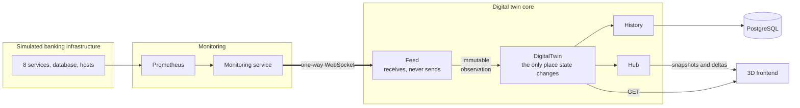
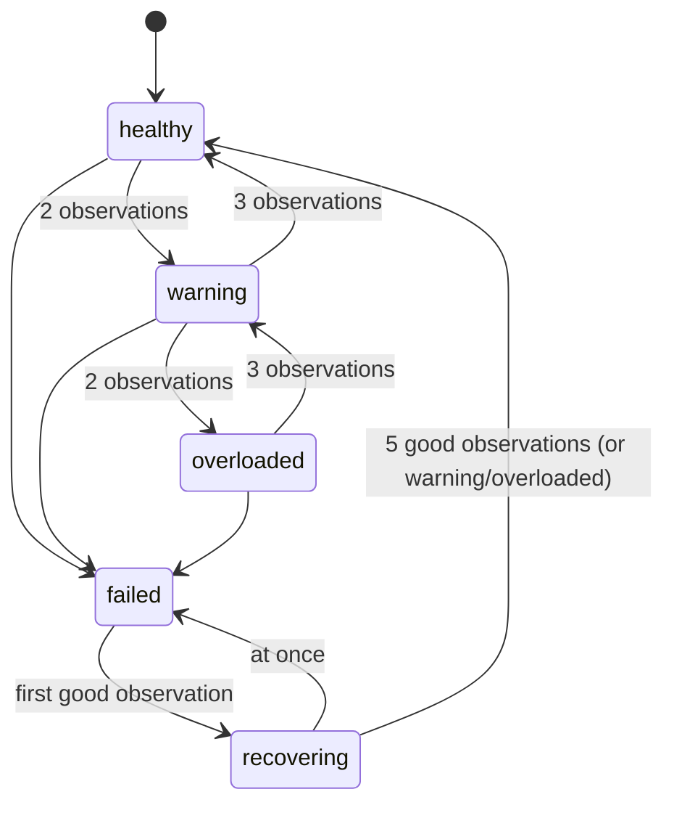

# 10 — Digital Twin Core

The core keeps a virtual copy of the complete banking infrastructure and synchronises it with what
monitoring reports. It lives in the backend (`backend/app/digital_twin/`) and is published as API
version 2. Version 1 (the Phase 1 twin) is unchanged. The 3D interface (doc 11) uses version 2.

## 1. Separation between the real system and its copy



* The twin knows the real system only through monitoring messages. It holds no key, imports nothing
  from the bank or the monitor, and has no HTTP client (a test checks the source code for this).
* Messages are untrusted input: checked for type, range, time zone, origin and order before they
  become an `Observation`, which is immutable.
* Everything handed out is a copy. `clone()` gives an independent twin for later what-if simulation.
* The API is read-only. WebSocket clients may ask for a resync or a subscription, nothing else.
* Its database role can append twin history and read measurements. It cannot change either.

## 2. The virtual infrastructure

| Type | Components | Observed through |
|---|---|---|
| `microservice` | `bank-authentication`, `bank-customer`, `bank-account`, `bank-transaction`, `bank-payment`, `bank-fraud`, `bank-notification`, `bank-database` | their own metrics |
| `database` | `store-bank` (the storage behind the Database Service) | its connection pool, query time, refused queries |
| | `store-platform` (PostgreSQL) | postgres-exporter |
| `server` | `server-docker` (the machine containers run on) | node-exporter |
| | `server-bank-host` (only while the bank runs as processes) | what it hosts; marked `derived` |
| `network` | `net-bank` | the calls it carries |
| `load_balancer` | `lb-clients` (client entry) | derived: each service's requests minus the measured internal calls |
| `gateway` | `gw-external` (external payment network) | derived: only through the Payment Gateway |
| `monitoring` | `mon-prometheus`, `mon-service` | Prometheus; the fact that messages arrive |

Connections (`source` depends on `target`): 14 measured `calls` between services (rate, failure rate,
latency, circuit breaker), and structural ones: `stores_in`, `hosted_on`, `connected_to`, `monitors`, and `routes_to`
(derived: traffic entering and leaving the bank).

The structure follows reality: services report whether they run as a process or in a container, and
the twin re-attaches them to the right server. `structure_version` then grows. A silent service stays
where it last was.

Every component has an id, type, status, metrics and its dependencies in both directions.

## 3. Statuses

| Status | Meaning |
|---|---|
| **healthy** | works normally |
| **warning** | works, but slower, with some errors, or it depends on something that has failed |
| **overloaded** | short of its own resources: CPU, memory, worker slots, queue, connections |
| **failed** | not reachable, or at least half of its requests fail |
| **recovering** | works again after a failure, not yet long enough to be trusted |
| **unknown** | nothing trustworthy is known |



Unreachable means failed at once; failing requests must persist for two observations (one every 2 s).
From any status, losing contact leads to *unknown*. That is not a cure: something that had failed
before is *recovering* afterwards, not healthy.

| Object | Warning | Overloaded | Failed |
|---|---|---|---|
| microservice | CPU 75 %, memory 80 %, errors 2 %, p95 1.8 × its baseline, any queue, a required or degradable dependency failed | CPU 90 %, memory 92 %, queue 25 % of its slots, 90 % of slots busy, p95 3 × baseline *and* strained itself | unreachable, errors 50 % |
| bank database | 1 % of queries refused, 75 % of pool, query time 50 ms | 95 % of pool, 250 ms | 50 % of queries refused |
| server, PostgreSQL | CPU 75 %, memory 85 %, 70 connections | CPU 90 %, memory 95 %, 90 connections | reported down |
| connection | 2 % fail, or half of its timeout used | – | 50 % fail, or circuit open |
| network | an unexplained failing connection | – | half of the connections to *working* services fail |
| client entry | 2 % of customer requests fail, a service behind it failed | – | 50 % fail, or no service behind it works |

Two rules avoid wrong conclusions. **Slow is not overloaded** unless the component is also short of
its own resources; otherwise it is waiting for something else. **The network is not blamed** for
calls whose target has itself failed. Ratios are ignored below 0.3 requests per second, and
with fewer than 20 requests in the window latency is judged by the mean, because a percentile of a few
requests is only the slowest of them.

`root_causes` names the failed components that nothing else explains. `reason` and `findings` (rule,
value, limit) say why.

## 4. Synchronisation

Every monitoring message (one every 2 s) is applied as it arrives; there is no polling. A message
that is repeated, older than what is applied, unusable, or marked as not fresh by monitoring itself is
counted and ignored. After 8 s without an applied message everything is *unknown* and `sync` is
`stale`. The connection is re-established by itself. `version` counts changes; `run_id` changes when
the twin restarts. Measured and synthetic data never flow into each other: when the origin changes,
the twin starts over.

## 5. History

| Table | Contents |
|---|---|
| `twin_transition` | every change of status, with reason and root causes |
| `twin_snapshot` | all statuses every 30 s, also while nothing changes: evidence that the twin was running |
| `twin_structure` | each distinct structure once |

A past moment is reconstructed from the snapshot before it plus the transitions since, with the
metrics measured then taken from the monitoring tables. Without evidence for 75 s the twin was not
running, and it says so (404, or `untracked` in a timeline) instead of guessing. During a database
outage, rows wait in memory. Retention is 30 days.

## 6. API version 2

All read-only. The exact format is
[`docs/api/twin-v2.schema.json`](api/twin-v2.schema.json) (a test fails if the code and the file
differ; `python scripts/export_twin_schema.py` updates it).

| Path under `/api/v2/twin` | Returns |
|---|---|
| *(root)* | the complete twin: meta, summary, components, links |
| `/summary`, `/catalogue`, `/sync` | counts and worst status; meanings and units; state of synchronisation |
| `/components?type=&status=`, `/components/{id}` | components |
| `/components/{id}/dependencies` | everything up- and downstream, and root causes |
| `/links?kind=&status=`, `/links/{id}` | connections |
| `/structure` | only what exists (supports `ETag`) |
| `/history/transitions`, `/history/state?at=`, `/history/timeline/{id}` | the past |
| WebSocket `/ws/v2/twin` | live updates |

### Format for the 3D frontend

```jsonc
{
  "meta": { "api_version": "2.0", "version": 412, "structure_version": 2, "run_id": "…",
            "sync": "live", "origin": "measured", "last_observation_at": "…" },
  "summary": { "overall": "failed", "by_status": { "healthy": 11, "failed": 1 },
               "needs_attention": ["bank-payment", "bank-transaction"] },
  "components": [ {
      "id": "bank-transaction", "type": "microservice", "name": "Transaction Processing Service",
      "criticality": 5, "status": "warning", "status_since": "…", "previous_status": "healthy",
      "reason": "depends on Payment Gateway Service, which has failed",
      "findings": [ { "level": "warning", "rule": "dependency_failed", "message": "…" } ],
      "root_causes": ["bank-payment"],
      "metrics": { "cpu_pct": 11.2, "rps": 3.1 }, "data_quality": "complete",
      "attributes": { "max_concurrency": 48, "deployment": "process" },
      "dependencies": { "depends_on": [ { "id": "bank-payment", "link_id": "…", "kind": "calls",
                                          "mode": "required", "status": "failed" } ],
                        "dependents": [] },
      "display": { "layer": "application", "group": "bank", "order": 7, "size": 5,
                   "load": 0.11, "attention": false } } ],
  "links": [ { "id": "bank-transaction->bank-payment", "source": "bank-transaction",
               "target": "bank-payment", "kind": "calls", "mode": "required", "status": "failed",
               "active": true, "metrics": { "calls_per_s": 1.2, "failure_rate": 1.0 },
               "display": { "flow": 0.17, "attention": true } } ]
}
```

* `display` has hints, not decisions: which plane (`layer`), stable position in it (`order`),
  importance (`size` 1–5), how busy (`load` 0–1, null if unknown), traffic (`flow` 0–1, logarithmic),
  whether to draw the eye (`attention`). Colours and coordinates belong to the frontend.
* A metric without a value is absent, never 0. Units are in `/catalogue`.
* Stable ids: an object keeps its id for its whole life.

### WebSocket

1. First message: `snapshot`, complete.
2. Then `delta` after every change: whole changed objects, to replace by id, plus `transitions` (for
   animation and log) and a new `summary`. A delta also contains objects whose *neighbours* changed,
   so that dependency entries and root causes stay right.
3. `base_version` must equal the version the client has. If not, send `{"type":"resync"}`.
4. `heartbeat` after 5 s without changes.
5. `{"type":"subscribe","components":["bank-account"]}` limits the stream; `null` for everything.
6. When the structure changes, a new `snapshot` is sent.

Nothing is queued per client. A slow client gets fewer, larger messages with the current state, so it
can fall behind but never be wrong.

### Opinions of the AI service

Each component has an `insight` (doc 12): an anomaly score, the probabilities of degradation and
failure, warnings and reasons, received one way from the AI service over `/ws/insights`. They are
checked like any other input, expire after 10 s, are accepted only for the same origin of data, and
**never change a status**. `summary` has `ai`, `anomalies` and `predicted`;
`/api/v2/twin/insights` lists all of them.

### Failure propagation

Each component also has an `impact` (doc 13): whether a current failure may reach it, how strongly,
along which chain, and whether its own measurements confirm it. Links carry
`display.propagation` and `display.propagation_step`, the summary `propagation`. Propagation events
are stored in `propagation_event` and judged 60 s after they opened. Endpoints under
`/api/v2/twin/propagation`.

## 7. Configuration

| Variable | Default | |
|---|---|---|
| `SIMUCORE_TWIN_ENABLED` | `true` | |
| `SIMUCORE_TWIN_MONITORING_WS` | `ws://127.0.0.1:8200/ws/metrics` | only the monitoring service is accepted |
| `SIMUCORE_TWIN_DATABASE_URL` | none | without it there is no history |
| `SIMUCORE_TWIN_STALE_AFTER_S` | `8` | |
| `SIMUCORE_TWIN_AI_WS` | `ws://127.0.0.1:8300/ws/insights` | only the AI service is accepted; empty: without opinions |
| `SIMUCORE_TWIN_RETENTION_DAYS` | `30` | |

## 8. Test results

`backend/live/twin_core_check.py` changes the real simulated bank and checks what the twin shows:
[bank as processes](../backend/results/twin_core.md), [as containers](../backend/results/twin_core_docker.md).

## 9. Known limits

* The twin is as good as monitoring: a service nobody calls shows no errors, so a broken but idle one
  looks healthy until it is used (crashes and hangs are seen regardless).
* A crash appears within about 3 s, failing requests and overload within about 4 to 14 s, because the
  10 s measuring window has to fill and the change has to persist.
* `server-bank-host` is not measured when the bank runs as processes; its state is derived.
* `net-bank` is judged by the calls it carries; there are no packet-level measurements.
* Thresholds are fixed. Learning them is part of the later calibration phase.
* Past metrics exist as long as the monitoring history does (30 days).
