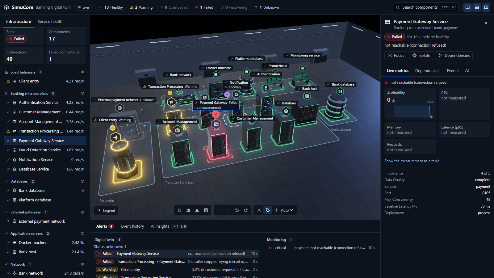
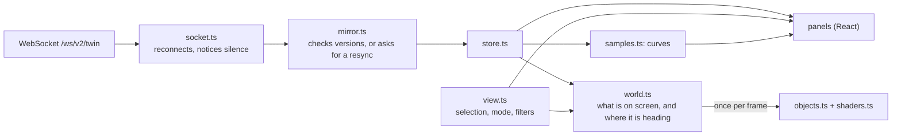

# 11 — Interactive 3D Interface

The interface shows the digital twin (doc 10) as a data centre in the browser. It lives in
`frontend/` and replaces the Phase 1 page. Doc 06 is the original design idea.



## 1. What is shown

| Object | Represents | Data |
|---|---|---|
| server rack with an icon plate | one **banking microservice** and its application servers | its own measurements |
| blade enclosure | an **application server**: the machine services run on | node-exporter, or derived from what it hosts |
| floor marking "Racks on …" | which racks run on which machine | the `hosted_on` links |
| cylinder | a **database** | connection pool, postgres-exporter |
| low switch | the **network** | the calls it carries |
| column | the **load balancer**, "Client entry" | derived, see below |
| portal | the **external gateway**, "External payment network" | derived, see below |
| desk with screens | **monitoring** | Prometheus, monitoring service |
| arc with moving lights | a connection with requests | the measured calls |
| cable on the floor | runs on / connected to / collects from | shown on demand or for the selected component |

Walls, cooling units, cable tray and lamps are scenery. They cannot be selected and carry no data.

**Load balancer and external gateway.** The simulated bank has no such processes. The twin therefore
has two *derived* components, marked as such everywhere:

* `lb-clients`: requests from outside = all requests of a service minus the measured internal calls.
  It warns when customer requests fail, and fails when no service behind it works.
* `gw-external`: the card network that the Payment Gateway simulates. It can be observed only through
  that service and is *unknown* when the service is down.

## 2. Statuses

Every status differs in symbol, word and movement, not only in colour. (The colours alone do not pass
a colour-blindness check; that is why.)

| Status | Look |
|---|---|
| healthy | steady light |
| warning | slow pulse, triangle sign |
| overloaded | fast pulse, glowing rack, waves on the floor, gauge sign |
| failed | servers dark, flashing red (1.2 times a second), cross sign, dashed connections |
| recovering | light running upwards |
| unknown | grey, dashed ring, no numbers |

A change of status sends one wave over the object. Failures and overloads also give a message and an
alert. Blinking rows follow the measured load. The number and speed of the moving lights follow the
measured traffic on a logarithmic scale; red lights are failing requests and do not arrive.

The opinions of the AI service (doc 12) are drawn outside the status ring and in their own colours: an
anomaly as a violet ring of moving dashes, a predictive warning as a pink arc as long as the event is
probable, each with a sign beside the plate and a line in the label. The status stays as measured.

When the page is not up to date (connection lost, twin not receiving measurements), a banner says
so, and the scene loses its colour.

## 3. Interaction

| | Mouse | Keyboard |
|---|---|---|
| rotate, pan, zoom | drag, right-drag, wheel | arrows, Shift+arrows, `+` `-` |
| views: overview, front, side, above | toolbar | `1` `2` `3` `4` |
| select | click an object, a connection, or a row | Tab, Enter |
| focus | double click, or button | `F` |
| isolate: only it and what it is connected to | button | `I` |
| dependency view | button | `D` |
| search by name, type, status, port | button | `Ctrl`+`K` or `/` |
| cables, names | toolbar | `C`, `L` |
| back, everything | × | `Esc`, `R` |

In the **dependency view** the scene rearranges itself: what depends on the selected component stands
to its left, what it depends on to its right, one column per step. A click on another component,
in the scene or in the graph in the panel, continues from there.

**Panels:** infrastructure overview (by type, can be hidden in the scene), service health, live metrics
with five-minute curves and a table, dependencies, alerts (twin and monitoring), event history
(two hours from the database plus live), AI insights. The numbers in the top bar highlight one status.

## 4. Structure of the code



| Folder | Contents |
|---|---|
| `src/twin/` | types of API v2, mirror, socket, stores, graph algorithms, units, symbols |
| `src/scene/` | layout, world, geometry, shaders, room, labels, camera |
| `src/ui/` | panels |
| `src/test/`, `e2e/` | unit tests; tests in a real browser |

No component name, position or value is written in the interface: names, structure, units and values
come from the twin, and the layout is computed from its links. A test enforces this.

**Drawing.** All components of one type are one instanced draw call with one merged geometry; all
connections are one, all requests another. Status, load, highlight and fading are attributes, and
lights, waves and blinking are computed on the graphics card. Connection state travels in one small
texture. Shadows are redrawn only when something moves. Labels are HTML, moved without React. On slow
machines the detail is reduced automatically (resolution, glow, shadows), or by hand in the toolbar.

**Security.** The page only reads. The single message it ever sends is `{"type":"resync"}`. It loads
nothing from other sites and stores nothing.

## 5. Running it

With the Docker stack (README) and the simulated bank running:

```powershell
cd banking-sim; .\.venv\Scripts\python bankctl.py up
```

```powershell
cd banking-sim; .\.venv\Scripts\python bankctl.py workload normal --duration 3600
```

Open http://localhost:8080. For development, `npm run dev` in `frontend` and http://localhost:5173.
To see something happen: `bankctl.py kill payment`, then `bankctl.py start payment`.

## 6. Tests

| | |
|---|---|
| `npm test` | 130 unit tests: mirror, socket, curves, graph, layout, animation, picking, camera, geometry, opinions of the AI, agreement with the published API format |
| `node e2e/run.mjs` | 36 checks in Microsoft Edge with real mouse and keyboard, real faults in the simulated bank: [results](../frontend/results/e2e.md) |

The browser tests need Edge and the Docker stack, start and stop the bank themselves, and take about 20
minutes. They compare the page with the twin through a read-only object, `window.__simucore`.

## 7. Known limits

* The interface can show a change only after the twin knows it: a crash after 2 to 4 s, overload and
  failing requests after about 4 to 14 s (docs 09 and 10). From the twin to the picture it takes
  about one frame.
* A service under total CPU exhaustion stops answering the monitor and is then shown as unknown, not as
  overloaded. That is what is known about it.
* Moving lights show the measured rate, not individual requests.
* Load balancer and external gateway are derived, as described above.
* "Simulate failure" of the Phase 1 page is not part of this interface: it worked on the Phase 1 twin
  (API v1, still available). What-if simulation on this twin is a later phase.
* Curves of components other than microservices begin when the page is opened.
* Performance was measured on one computer (NVIDIA RTX 3050 Laptop, plugged in). With a nearly empty
  battery it fell to 21 frames per second even with 17 components. Machines without a graphics card
  were not measured; without WebGL the panels work and the scene says what is missing.
* Tested in Microsoft Edge; other browsers were not tested.
