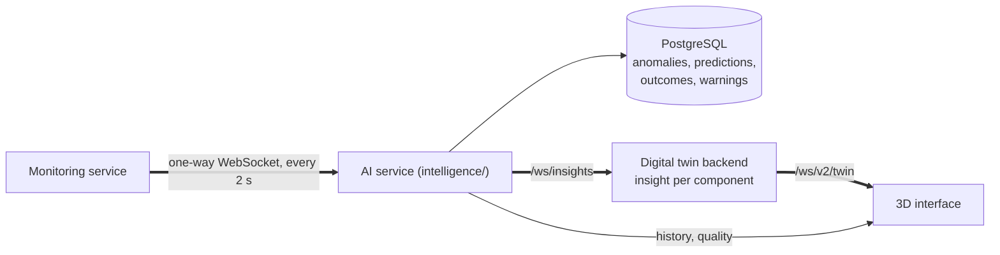

# 12 — Anomaly Detection and Failure Prediction

Two different questions, answered by two different methods that are never mixed:

| | Isolation Forest | XGBoost |
|---|---|---|
| Question | Is this moment unusual? | How likely does the service degrade or fail within 2 minutes? |
| Learning | unsupervised: no labels | supervised: labelled examples of what happened afterwards |
| Looks at | one moment | the last 60 seconds |
| Answer | anomaly score 0–1 (0.5 = threshold), kind of condition | calibrated probability, reasons |
| Says about the future | nothing | the probability, nothing more |

Neither changes a status. The digital twin's statuses rest on measurements; these are opinions about
them, shown as such. Nothing the module concludes can act on the bank.



## 1. Inputs

CPU utilisation, memory utilisation, request latency (mean), error rate, requests per second, network
traffic, database response time, active connections.

* **Isolation Forest** (one per service): these eight, normalised with the service's own profile (centre
  and spread of normal operation), plus CPU per request, bytes per request, the largest and the typical
  deviation. The last two exist because a forest looks at one random quantity per split and would
  otherwise hardly notice a moment in which only one of ten is extreme.
* **XGBoost** (one per target, for all services): for each of the eight the value now, the 20 s mean, the
  change, the 60 s trend and the fluctuation; distances to limits (time until memory or CPU is full,
  queue, slots, database pool); and the state of the services it depends on.

Unknown values stay unknown; they are never replaced by zero.

## 2. What is predicted

| Target | The service … |
|---|---|
| **failure** | becomes unavailable, or at least half of its requests fail |
| **degradation** | becomes short of CPU, memory, queue or slots (or slow while strained), stops answering monitoring, or fails |

These are the digital twin's own limits (a test compares them). For a moment *t* the label is 1 if the
condition begins in (*t* + 4 s, *t* + 120 s]. Not used: moments in which it is already present or was
within the last 60 s, those less than 4 s before, and the last 120 s of a recording, whose future is
unknown.

Probabilities are calibrated (isotonic regression). A **warning** opens when the probability exceeds the
threshold twice in a row, and ends below 60 % of it. Thresholds were chosen for 80 % precision on a
calibration set.

## 3. Data

**Calibration.** Eight recordings of the running bank under different loads, with nothing wrong, give the
profiles and the parameters of the generator (`calibrate.py`).

**Synthetic data** (`generator.py`). The bank as a small queueing model: arrivals, capacity, queues,
dependencies with timeouts, monitoring's 10 s windows, scrape errors. Per episode, one thing may happen:

| Group | Examples | Purpose |
|---|---|---|
| gradual | CPU, leak, leak and crash, slowness, pool, load, errors, slots | can be predicted |
| sudden | crash, outage | **cannot** be predicted; a test checks that the data contains no sign |
| recovering | the same as gradual, but it gets better by itself | looks alike, is not a failure |
| harmless | short blips, waves of customers, restart, nothing | false alarms |

Labels are derived from the resulting numbers, never from what was injected.

**Sets**, split by episode and seed, never by row: train 700, valid 140, calibration 220, test 260, and
160 from a *shifted* world (other noise, costs, loads, speeds). About 2.7 million rows.

**Recordings** (`live/record.py`): 30 runs of the real simulated bank through the whole chain, made **after**
the models were frozen, with faults and times drawn from a seed. They were not trained on.

### Against leakage

* Features of row *t* do not change when everything after *t* is replaced by nonsense (test).
* Training and live scoring use the same functions; the live engine reproduces the training table (test).
* No set shares an episode or seed (test). Profiles come from recordings used for nothing else.
* Boosting is stopped on one set, calibrated on another, tested on a third.
* On shuffled labels the models learn nothing: ROC-AUC 0.51 and 0.50 (mean of five), 0.86 and 0.87 with
  the true ones.
* The first test set was looked at while features were designed. It therefore counts as development
  data; the numbers below come from episodes generated for the first time after freezing (`final.py`).

## 4. Results

Complete: [synthetic](../intelligence/results/synthetic.md), [real simulated bank](../intelligence/results/validation.md).

| | Precision | Recall | F1 | ROC-AUC |
|---|---|---|---|---|
| **Fresh synthetic test set** | | | | |
| Isolation Forest, anomaly now | 0.98 | 0.75 | 0.85 | 0.93 |
| XGBoost, degradation | 0.77 | 0.44 | 0.56 | 0.85 |
| XGBoost, failure | 0.76 | 0.51 | 0.61 | 0.87 |
| **30 runs of the real simulated bank** | | | | |
| Isolation Forest, anomaly now | 0.68 | 0.65 | 0.67 | 0.83 |
| XGBoost, degradation | 0.89 | 0.52 | 0.65 | 0.90 |
| XGBoost, failure | 0.84 | 0.56 | 0.67 | 0.90 |

Rows 100 s ahead of a failure often contain no sign yet; that limits recall. What an operator experiences
on the real bank:

| | Degradation | Failure |
|---|---|---|
| announced | 37 of 42 | 34 of 39 |
| of those that came gradually | 37 of 38 | 34 of 35 |
| of those that came suddenly | 0 of 4 | 0 of 4 |
| median warning time | 70 s | 72 s |
| at least 30 s before | 35 | 30 |
| warnings that did not come true | 15 of 55 | 21 of 57 |

Each affected service counts; the 39 failures belong to 18 incidents, of which 14 were announced for at
least one service (the others: three sudden ones, and one CPU exhaustion).

### Honest comparison with simpler methods

* **Logistic regression** on the same features is as good as XGBoost on synthetic data (failure: ROC-AUC
  0.862 against 0.868; 0.880 against 0.879 in the shifted world). Most of the power lies in the features.
  XGBoost was required and gives exact explanations; a clear advantage in accuracy was not found.
* **A simple rule** ("how near is the worst value to its limit?") reaches ROC-AUC 0.71 on the real bank.
  Tuned to find as many failures as XGBoost, its precision is 0.34 instead of 0.84.
* **The largest deviation** alone orders moments about as well as the Isolation Forest (ROC-AUC 0.932
  against 0.933). The forest adds one threshold per service with a chosen false alarm rate.

### What the numbers do not say

* They hold for this simulated bank, these faults, this computer. They are no claim about real banks.
* Probabilities are calibrated on synthetic data; on the real recordings the model was rather too cautious
  (said 0.48, happened 0.65). The share of failing time in the recordings is far higher than in normal life,
  so precision in quiet operation will be lower. The service records the outcome of every prediction, so
  that its quality in operation can be read from the database at any time.
* **Drift.** In the development recordings 0.5 % of normal moments were called unusual; over the three
  hours of test recordings, in which the bank ran without a restart, 6.8 %. Two causes: after an overload the Account
  Service kept about 40 % more memory for good, and the computer was faster than during calibration. The
  profiles are fixed; adapting them is the task of the self-calibration phase. The live check measures
  the rate of such anomalies in normal operation (A02) and reports it instead of judging it: in the
  final run 9 short "traffic" anomalies in 5 minutes (5 % of the time), all on the two services with the
  least traffic (Payment, about 2 requests/s; Notification, under 1). With so few requests per 10 s window
  the bytes and latency per request vary more than in the calibration. This is the weakest point of the
  anomaly detection; predictive warnings are not affected (none in normal operation).
* Faults that show in none of the metrics (held worker slots) are announced only seconds before, or not.

## 5. The AI service

`intelligence/`, port 8300, own database role. It scores all services within about 25 ms per tick.

* **Anomaly event**: opens when 2 of the last 3 moments are unusual, closes after 4 ordinary ones. Stored
  with score, level, kind of condition (traffic, resources, latency, errors, database, connections) and
  contributions: how much less unusual the moment would be if a metric were normal.
* **Prediction**: stored every 10 s per service and target, with reasons (TreeSHAP, exact) when the risk is
  raised, and with its **outcome** two minutes later.
* **Warning**: stored with probability, reasons, and later *came true* (with warning time), *did not
  happen*, or *not known* (contact lost, restart).
* No opinion is given about a service that is down or does not answer, without 30 s of data, or (for a
  target) while it is present and for 60 s after. Opinions expire after 8 s without data. Measured and
  synthetic data never mix.
* Models are stored without pickle: the forests as plain arrays (a test shows that the scores equal
  scikit-learn's), XGBoost as JSON.

| Path under `/api/v1/ai` (read-only) | |
|---|---|
| `/status`, `/model` | state; what the models are and how well they did where |
| `/insights` | current opinions |
| `/anomalies`, `/warnings`, `/predictions/{node}` | history |
| `/performance` | what became of predictions and warnings |
| WebSocket `/ws/insights` | snapshot, then an update every 2 s |

## 6. In the twin and the 3D interface

Each component of the twin has an `insight` (doc 10). In the scene, an anomaly is a violet ring of moving
dashes, a predictive warning a pink arc as long as the event is probable, with signs and a line in the
label; a message appears when a warning opens. The **AI insights** tab shows detected anomalies,
predicted failures with probabilities, important metrics, the history with outcomes, and the measured
quality of the models with its source. The inspector has an AI tab with curves per service.

## 7. Using it

```powershell
cd intelligence; python -m venv .venv; .\.venv\Scripts\pip install -r requirements-dev.txt
```

| | |
|---|---|
| `python -m pytest` | unit tests |
| `python live/record.py calibration` (or `dev`, `test`) | record the running bank |
| `python -m simucore_ai.calibrate` | profiles and generator parameters |
| `python -m simucore_ai.train` | train (about 9 minutes) |
| `python -m simucore_ai.final` | measure frozen models on fresh episodes |
| `python -m simucore_ai.validate test` | judge them on the recordings |
| `python live/ai_check.py` | the whole pipeline with real faults: [results](../intelligence/results/pipeline.md) |

After retraining, restart the service. New models need new test recordings to be judged fairly.

To see a predicted failure: start the bank and a workload (doc 11), then let memory grow step by step with
`bankctl.py fault account resource_exhaustion --mode memory --magnitude 0.3` … `1.0`.

## 8. Found on the way

`bankctl fault … memory` measured the memory from a cache that still contained what the previous step had
allocated, so a leak raised step by step kept falling back. Fixed in the bank, with a test. The five
development recordings with leaks were discarded; the test recordings were made afterwards.
